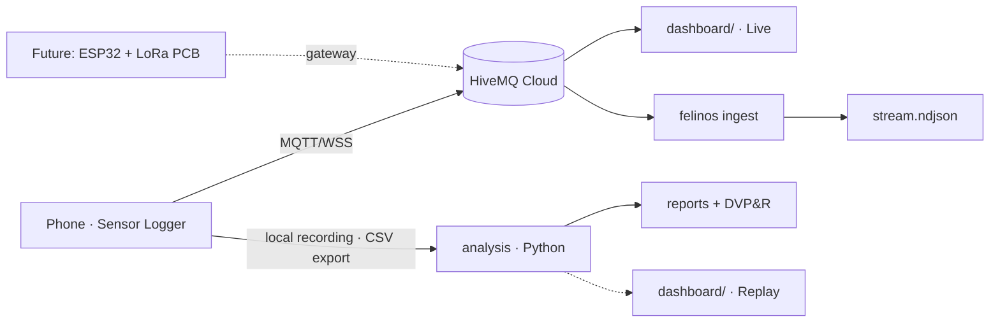

# felinos-telemetry

[](https://github.com/felinos-racing/felinos-telemetry/actions/workflows/ci.yml)
[](LICENSE)

**End-to-end vehicle data acquisition and verification pipeline for a Baja SAE off-road prototype: live telemetry, automated test analysis and requirements traceability (DVP&R).**

Built by **Felinos Racing** (Universidad La Salle Bajío) for Baja SAE México 2026.

## What it does

- **Live telemetry** — a phone running [Sensor Logger](https://www.tszheichoi.com/sensorlogger) streams IMU, GPS and barometer data over MQTT (WebSocket + TLS) to a managed broker. A static dashboard in the pits shows speed, accelerations, yaw rate, grade, a G-G diagram and an offline track map.
- **Ingest service** — `felinos ingest` subscribes to the broker and writes every message to NDJSON (one file per session) as a backup of the stream. It is built around a `Sink` interface so a database sink can be added later.
- **Offline analysis** *(v0.2)* — the phone's local recording is the source of truth. Python tools parse the CSV export, align sensors, rotate to vehicle axes and evaluate each vehicle goal (acceleration, turning radius, hill climb, fatigue usage profile).

## Architecture



See [docs/architecture.md](docs/architecture.md) for details.

## Quickstart

Requires Python ≥ 3.11.

```bash
python -m venv .venv
# Windows: .venv\Scripts\activate    macOS/Linux: source .venv/bin/activate
pip install -e ".[dev]"

cp .env.example .env          # fill in broker host and credentials
felinos ingest                # stream → data/stream/<sessionId>.ndjson
```

Dashboard:

```bash
cp dashboard/config.example.js dashboard/config.js   # fill in read-only MQTT user
python -m http.server 8000 --directory dashboard
# open http://localhost:8000  (add ?lang=es for Spanish)
```

Parse a Sensor Logger export in Python:

```python
from felinos_telemetry.io.sensorlogger import read_export, pivot_sensor

long_df = read_export("path/to/export.zip")  # columns: time_ns, sensor, field, value
accel = pivot_sensor(long_df, "accelerometer")  # columns: time_ns, x, y, z
```

## Development

```bash
ruff check . && ruff format --check . && mypy && pytest
pre-commit install
```

Conventions: Conventional Commits, SemVer tags, [Keep a Changelog](CHANGELOG.md). See [CONTRIBUTING.md](CONTRIBUTING.md).

## Roadmap

- **v0.1.0** — repo skeleton, run metadata models, Sensor Logger parser (stream + CSV), MQTT → NDJSON ingest, live dashboard, field guides.
- **v0.2.0** — data quality, axis alignment, resampling; analysis for VG-04/05/06, events and rainflow; per-run reports and DVP&R table; dashboard Replay; PSD export for random vibration.
- **v0.3.0+** — PostgreSQL sink and run importer, team web platform, telemetry PCB integration (LoRa → MQTT).

## Engineering decisions

Architecture Decision Records live in [docs/adr/](docs/adr/).

## License

[MIT](LICENSE)
