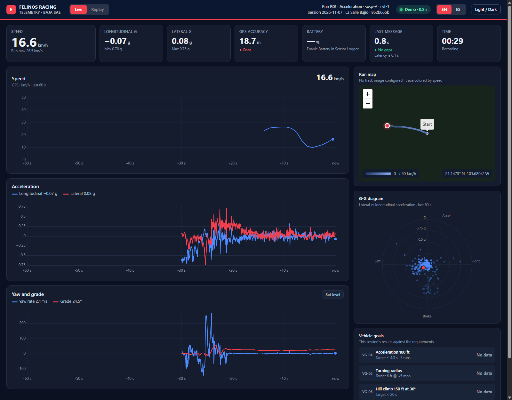
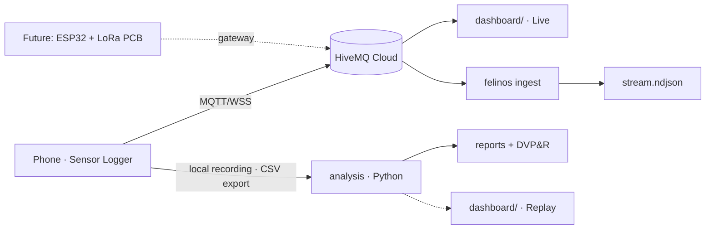

# felinos-telemetry

[](https://github.com/deborahvp/FelinosTelemetry-Baja/actions/workflows/ci.yml)
[](LICENSE)

**End-to-end vehicle data acquisition and verification pipeline for a Baja SAE off-road prototype: live telemetry, automated test analysis and requirements traceability (DVP&R).**

Built by **Felinos Racing** (Universidad La Salle Bajío) for Baja SAE México 2026.



## What it does

- **Live telemetry** — a phone running [Sensor Logger](https://www.tszheichoi.com/sensorlogger) streams IMU, GPS and barometer data over MQTT (WebSocket + TLS) to a managed broker. A static dashboard in the pits shows speed, accelerations, yaw rate, grade, a G-G diagram and an offline track map.
- **Ingest service** — `felinos ingest` subscribes to the broker and writes every message to NDJSON (one file per session) as a backup of the stream. It is built around a `Sink` interface so a database sink can be added later.
- **Offline analysis** *(v0.2)* — the phone's local recording is the source of truth. Python tools parse the CSV export, align sensors, rotate to vehicle axes and evaluate each vehicle goal (acceleration, turning radius, hill climb, fatigue usage profile).

## Architecture



See [docs/architecture.md](docs/architecture.md) for details.

## Quickstart

Requires Python ≥ 3.11.

```bash
python -m venv .venv
# Windows: .venv\Scripts\activate    macOS/Linux: source .venv/bin/activate
pip install -e ".[dev]"

cp .env.example .env          # fill in broker host and credentials
felinos ingest                # stream → data/stream/<sessionId>.ndjson
```

Dashboard:

```bash
cp dashboard/config.example.js dashboard/config.js   # fill in read-only MQTT user
felinos dashboard                                    # serves dashboard/ and opens the browser
# English by default; EN | ES selector in the top bar (or ?lang=es)
```

Rehearse without the car:

```bash
felinos simulate tests/fixtures/sample_export --publish --env-file .env.phone  # replay 60 s as the phone user
felinos simulate tests/fixtures/sample_export --out dashboard/assets/demo.ndjson
# then open http://localhost:8000/?demo=assets/demo.ndjson         # no broker needed
```

Check a recording after each run:

```bash
felinos check path/to/sensorlogger.zip      # sensors, sample rate, duration
```

Analyze runs (official results from the phone's recording):

```bash
felinos analyze data/2026-11-08/R01_acceleration_susp-A_cvt-1   # results/summary.json, events.csv, report.md
felinos usage data --csv data/usage.csv                          # accumulated hours, km, impacts (VG-02)
```

Each report covers data quality, usage (active time from GPS, IMU vibration where GPS is missing),
events (impacts, jumps, hard braking/cornering), the vehicle goals verified by the run's test type
(VG-04 time to 100 ft, VG-05 turning radius, VG-06 hill climb) and durability (ASTM E1049 rainflow,
pseudo-damage, equivalent hours). See [docs/durability-hours.es.md](docs/durability-hours.es.md).

Hosted dashboard: `dashboard/` deploys as-is to any static host (Vercel: Root Directory
`dashboard`, no build). It ships no credentials — each browser enters the read-only broker user
once in the **Connection** dialog. See [docs/deploy-vercel.es.md](docs/deploy-vercel.es.md).

Field guides for the team (Spanish, printable): [field guide](docs/field-guide.es.md) ·
[Sensor Logger + HiveMQ setup](docs/sensorlogger-setup.es.md). Data dictionary:
[docs/data-format.md](docs/data-format.md).

Parse a Sensor Logger export in Python:

```python
from felinos_telemetry.io.sensorlogger import read_export, pivot_sensor

long_df = read_export("path/to/export.zip")  # columns: time_ns, sensor, field, value
accel = pivot_sensor(long_df, "accelerometer")  # columns: time_ns, x, y, z
```

## Development

```bash
ruff check . && ruff format --check . && mypy && pytest
node --test "tests/dashboard/*.test.mjs"     # dashboard logic (Node ≥ 22)
pre-commit install
```

Conventions: Conventional Commits, SemVer tags, [Keep a Changelog](CHANGELOG.md). See [CONTRIBUTING.md](CONTRIBUTING.md).

## Roadmap

- **v0.1.0** — repo skeleton, run metadata models, Sensor Logger parser (stream + CSV), MQTT → NDJSON ingest, live dashboard, field guides.
- **v0.2.0** *(in progress)* — ✅ data quality, axis alignment, usage, events, VG-04/05/06, rainflow and equivalent hours, per-run reports, live goals panel · ⏳ resampling, Kasa circle-fit cross-check, figures, DVP&R table, dashboard Replay, PSD export for random vibration.
- **v0.3.0+** — PostgreSQL sink and run importer, team web platform, telemetry PCB integration (LoRa → MQTT).

## Engineering decisions

- [ADR 0001 — MQTT over WebSocket/TLS through a managed broker](docs/adr/0001-mqtt.md)
- [ADR 0002 — The phone's local recording is the source of truth](docs/adr/0002-local-recording-source-of-truth.md)

## License

© 2026 Deborah Villicaña Prieto. **All rights reserved.** Proprietary software, not open
source: see [LICENSE](LICENSE). The Felinos Racing team may use it for its own testing while the
author authorizes it; any other use, copy, modification or distribution requires the author's
written permission. Third-party libraries in `dashboard/vendor/` keep their own licenses.
