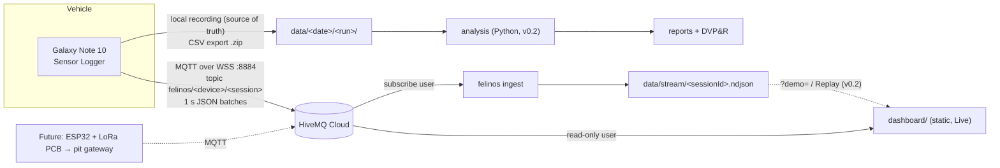

# Architecture



## Components

| Component | Path | Role |
| --- | --- | --- |
| Parser | `src/felinos_telemetry/io/sensorlogger.py` | MQTT messages and CSV exports → one long DataFrame (`time_ns, sensor, field, value`). Only `parse_message` knows the message format. |
| NDJSON | `src/felinos_telemetry/io/ndjson.py` | Stream backup format (raw message + receive time). |
| Ingest | `src/felinos_telemetry/ingest/` | paho-mqtt v2 subscriber → `Sink`s. `NdjsonSink` today, `PostgresSink` later. Auto-reconnect with backoff. |
| Models | `src/felinos_telemetry/models.py` | `RunMeta` (`meta.yaml`), `VehicleConfig`, `Requirement`. |
| Simulator | `src/felinos_telemetry/simulate.py` | Export → Sensor Logger messages, to rehearse without the car. |
| Dashboard | `dashboard/` | Static ES modules, no build. MQTT.js, uPlot, Leaflet from CDN with pinned versions. |

## Dashboard data flow

```
mqtt.js ──message──▶ state.js Store ──▶ Session
                                   ├─ vehicle.js: phone axes → ISO 8855 vehicle axes
                                   │   (axisMap + gravity level reference, tilt removed)
                                   ├─ Decimator: 100 Hz → 25 Hz (plotting only)
                                   └─ GPS trace, battery, gaps, latency
app.js (every 250 ms) ──▶ charts.js (uPlot) · map.js (Leaflet) · gg.js (SVG) · KPIs
```

The whole session stays in memory, so charts can be zoomed back in history while the live
window keeps following. All user-facing strings live in `dashboard/i18n.js` (English default,
Spanish), and a test fails if any key is missing.

## Design decisions

See [ADRs](adr/).
